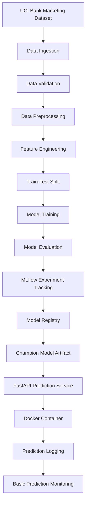

# Bank Marketing Subscription Prediction — End-to-End MLOps

An end-to-end Machine Learning and MLOps project that predicts whether a bank customer will subscribe to a term deposit based on customer demographics, financial information, and previous campaign interactions.

## Project Overview

This project demonstrates an end-to-end machine learning workflow, including:

- Data ingestion and validation
- Data preprocessing and feature engineering
- Model training, evaluation, and hyperparameter tuning
- MLflow experiment tracking and model registry
- FastAPI prediction service
- Docker containerization and deployment
- GitHub Actions CI/CD automation
- Docker image publishing to GitHub Container Registry (GHCR)
- Persistent prediction logging and basic monitoring

## Tech Stack

Python · Pandas · Scikit-learn · MLflow · FastAPI · Docker · GitHub Actions · GHCR · Pytest

## Model Performance

Two baseline classification models were evaluated:

| Model | Accuracy | Precision | Recall | F1-Score | ROC-AUC |
|---|---:|---:|---:|---:|---:|
| Logistic Regression | 0.8303 | 0.3591 | 0.6455 | 0.4615 | 0.8002 |
| Random Forest | 0.8746 | 0.4456 | 0.4634 | 0.4543 | 0.7860 |

## CI/CD Pipeline

GitHub Actions automates the project's testing, Docker image building, and publishing workflow.

The pipeline consists of three jobs:

1. **Run Tests:** Installs project dependencies and executes the Pytest test suite.
2. **Build Docker Image:** Builds the Docker image after successful tests.
3. **Publish Docker Image:** Publishes the image to GitHub Container Registry when changes are pushed to the `main` branch.

The publishing job runs only after both testing and Docker image building succeed.

## Published Docker Image

The project Docker image is published to GitHub Container Registry (GHCR).

**Image:**

`ghcr.io/pranshi-22/end-to-end-bank-marketing-mlops:main`

[View Docker Package on GitHub](https://github.com/pranshi-22/end-to-end-bank-marketing-mlops/pkgs/container/end-to-end-bank-marketing-mlops)

### Pull the Published Image

```bash
docker pull ghcr.io/pranshi-22/end-to-end-bank-marketing-mlops:main
```

### Run the Container

```bash
docker run -d \
  --name bank-marketing-api \
  -p 8000:8000 \
  -v "$(pwd)/logs:/app/logs" \
  ghcr.io/pranshi-22/end-to-end-bank-marketing-mlops:main
```

The volume mount persists prediction logs in the local `logs/` directory even if the container is removed.

## System Architecture



### Prediction Workflow

1. Customer data is submitted through the FastAPI endpoint.
2. The trained preprocessing and classification pipeline transforms the input.
3. The model generates a subscription prediction and probability.
4. The API returns the prediction and records it in a CSV log.
5. The monitoring script analyses logged predictions and generates a summary report.

## Installation and Setup

### 1. Clone the Repository

```bash
git clone https://github.com/pranshi-22/end-to-end-bank-marketing-mlops.git
cd end-to-end-bank-marketing-mlops
```

### 2. Create a Virtual Environment

```bash
python -m venv .venv
```

Activate it:

**Windows PowerShell**

```powershell
.venv\Scripts\Activate.ps1
```

**Linux / macOS**

```bash
source .venv/bin/activate
```

### 3. Install Dependencies

```bash
pip install -r requirements.txt
```

## Running the API

Start the FastAPI application:

```bash
uvicorn src.api:app --reload
```

Open the interactive API documentation:

http://127.0.0.1:8000/docs

## Running with Docker Compose

Build and start the application:

```bash
docker compose up -d --build
```

Check the running container:

```bash
docker compose ps
```

View application logs:

```bash
docker compose logs -f
```

Stop the application:

```bash
docker compose down
```

The Docker Compose configuration mounts the local `logs/` directory into the container to persist prediction records.

## Prediction Logging and Monitoring

Every prediction request is recorded in:

`logs/predictions.csv`

The log contains customer input features, predicted subscription outcome, subscription probability, and UTC timestamp.

### Monitoring Report

Run the monitoring script inside the running Docker container:

```bash
docker exec bank-marketing-container python -m src.monitoring.monitor_predictions
```

The monitoring script reports:

- Total number of predictions
- Distribution of `yes` and `no` predictions
- Average subscription probability

**Example monitoring results from the development environment:**

| Metric | Result |
|---|---:|
| Total Predictions | 18 |
| Predicted Yes | 9 |
| Predicted No | 9 |
| Average Subscription Probability | 0.5493 |

These results represent logged prediction activity, not measured model accuracy or drift.

## Running Tests

Execute the test suite:

```bash
pytest
```

The test suite includes API, data validation, ingestion, model prediction, and monitoring tests.

## API Usage

### Prediction Endpoint

`POST /predict`

The endpoint accepts customer information and returns the predicted subscription outcome along with its probability.

### Sample Request

```json
{
  "customer_data": {
    "age": 35,
    "job": "management",
    "marital": "married",
    "education": "university.degree",
    "default": "no",
    "housing": "yes",
    "loan": "no",
    "contact": "cellular",
    "month": "may",
    "day_of_week": "mon",
    "campaign": 1,
    "pdays": 999,
    "previous": 0,
    "poutcome": "nonexistent",
    "emp.var.rate": 1.1,
    "cons.price.idx": 93.994,
    "cons.conf.idx": -36.4,
    "euribor3m": 4.857,
    "nr.employed": 5191.0
  }
}
```

### Sample Response

```json
{
  "prediction": "no",
  "subscription_probability": 0.3404
}
```

*The sample response is from an actual test request. Predictions and probabilities vary with customer input.*

### API Documentation

FastAPI provides interactive API documentation through Swagger UI:

http://localhost:8000/docs

## Dataset

This project uses the **Bank Marketing Dataset** from the UCI Machine Learning Repository.

- Original records: 41,188
- Records after duplicate removal: 41,176
- Features: 19 (excluding the target variable)
- Target variable: `y`
- Prediction task: Binary classification (`yes` / `no`)
- Train-test split: 80:20 with stratification

The target variable indicates whether a customer subscribed to a term deposit.

### Data Preprocessing

- Removed 12 duplicate records.
- Preserved `unknown` categorical values.
- Handled numerical missing values using median imputation.
- Handled categorical missing values using most-frequent imputation.
- Applied StandardScaler to numerical features.
- Applied OneHotEncoder to categorical features.
- Excluded `duration` to avoid post-call information leakage in pre-call prediction.

## Project Structure

```text
end-to-end-bank-marketing-mlops/
│
├── artifacts/
│   └── champion_model/
│
├── configs/
│   └── config.yaml
│
├── reports/
│   └── evaluation/
│
├── src/
│   ├── data/
│   ├── features/
│   ├── models/
│   ├── pipelines/
│   ├── monitoring/
│   ├── utils/
│   └── api.py
│
├── tests/
│
├── .github/
│   └── workflows/
│       └── ci.yml
│
├── Dockerfile
├── docker-compose.yml
├── requirements.txt
├── pytest.ini
└── README.md
```

### Hyperparameter Tuning

Logistic Regression was further tuned using GridSearchCV.

- Best parameters: `C=10`, `class_weight='balanced'`
- Best cross-validation F1-score: `0.4504`
- Test F1-score: `0.4618`
- Test ROC-AUC: `0.8003`

The tuned Logistic Regression achieved a marginally higher test F1-score than the baseline Logistic Regression.

### Evaluation Visualizations

Confusion matrices and ROC curve comparisons are available in the `reports/evaluation/` directory.

## Project Status

- [x] Data ingestion and validation
- [x] Data preprocessing and feature engineering
- [x] Model training and evaluation
- [x] Hyperparameter tuning
- [x] MLflow experiment tracking
- [x] Model registration and Champion model selection
- [x] FastAPI prediction endpoint
- [x] Docker containerization
- [x] Automated testing with Pytest
- [x] GitHub Actions CI/CD workflow
- [x] Docker image publishing to GHCR
- [x] Containerized API deployment verification
- [x] Persistent prediction logging
- [x] Basic prediction monitoring

---

**Author:** Pranshi Sharma

**GitHub Repository:** https://github.com/pranshi-22/end-to-end-bank-marketing-mlops