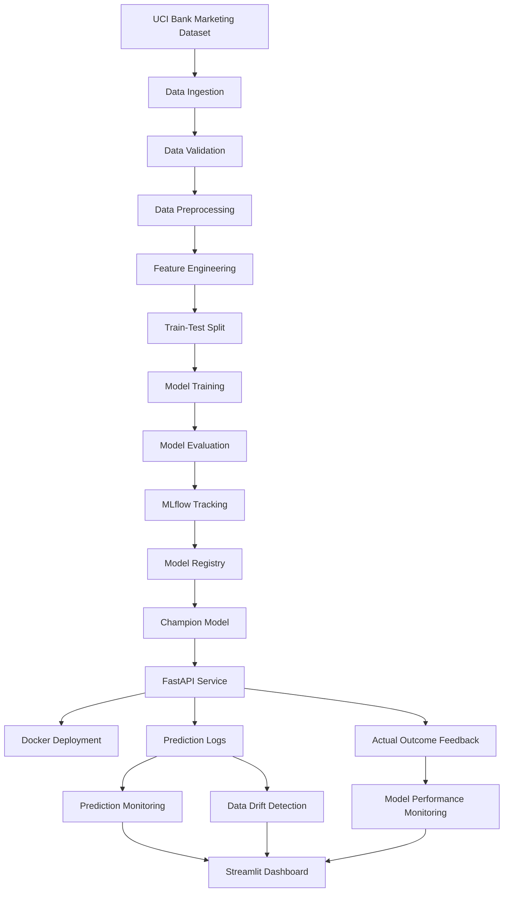

# Bank Marketing Subscription Prediction — End-to-End MLOps

An end-to-end Machine Learning and MLOps project that predicts whether a bank customer will subscribe to a term deposit based on customer demographics, financial information, and previous campaign interactions.

The project demonstrates the complete ML lifecycle, from data ingestion and model training to API deployment, automated CI/CD, production monitoring, and an interactive monitoring dashboard.

## Project Overview

This project demonstrates:

- Data ingestion and validation
- Data preprocessing and feature engineering
- Model training, evaluation, and hyperparameter tuning
- MLflow experiment tracking and model registry
- Champion model selection
- FastAPI prediction and feedback endpoints
- Docker containerization and deployment
- GitHub Actions CI/CD automation
- Docker image publishing to GitHub Container Registry (GHCR)
- Persistent prediction and feedback logging
- Production input data drift detection using Evidently AI
- Actual outcome-based model performance monitoring
- Interactive Streamlit monitoring dashboard
- Monitoring alerts

## Tech Stack

**Programming:** Python, Pandas, NumPy

**Machine Learning:** Scikit-learn

**Experiment Tracking:** MLflow

**API:** FastAPI, Uvicorn

**Monitoring:** Evidently AI, Scikit-learn

**Dashboard:** Streamlit

**Deployment:** Docker, Docker Compose

**CI/CD:** GitHub Actions, GitHub Container Registry

**Testing:** Pytest

## Model Performance

Two baseline classification models were evaluated:

| Model | Accuracy | Precision | Recall | F1-Score | ROC-AUC |
|---|---:|---:|---:|---:|---:|
| Logistic Regression | 0.8303 | 0.3591 | 0.6455 | 0.4615 | 0.8002 |
| Random Forest | 0.8746 | 0.4456 | 0.4634 | 0.4543 | 0.7860 |

### Hyperparameter Tuning

Logistic Regression was further tuned using GridSearchCV.

- Best parameters: `C=10`, `class_weight='balanced'`
- Best cross-validation F1-score: `0.4504`
- Test F1-score: `0.4618`
- Test ROC-AUC: `0.8003`

The tuned Logistic Regression achieved a marginally higher test F1-score than the baseline Logistic Regression.

## System Architecture



## API Usage

The FastAPI service provides prediction and feedback endpoints.

### Prediction Endpoint

`POST /predict`

Accepts customer information and returns a prediction, subscription probability, and a unique prediction ID.

**Sample request:**

```json
{
  "customer_data": {
    "age": 35,
    "job": "management",
    "marital": "married",
    "education": "university.degree",
    "default": "no",
    "housing": "yes",
    "loan": "no",
    "contact": "cellular",
    "month": "may",
    "day_of_week": "mon",
    "campaign": 1,
    "pdays": 999,
    "previous": 0,
    "poutcome": "nonexistent",
    "emp.var.rate": 1.1,
    "cons.price.idx": 93.994,
    "cons.conf.idx": -36.4,
    "euribor3m": 4.857,
    "nr.employed": 5191.0
  }
}
```

**Sample response:**

```json
{
  "prediction_id": "generated-uuid",
  "prediction": "no",
  "subscription_probability": 0.3404
}
```

The prediction ID is used to associate a prediction with its eventual actual outcome.

### Actual Outcome Feedback Endpoint

`POST /feedback`

Records the actual outcome associated with a previously generated prediction.

**Sample request:**

```json
{
  "prediction_id": "generated-uuid",
  "actual_outcome": "no"
}
```

**Sample response:**

```json
{
  "message": "Feedback recorded successfully",
  "prediction_id": "generated-uuid",
  "actual_outcome": "no"
}
```

Actual outcomes are stored in:

`logs/actual_outcomes.csv`

This feedback enables the project to evaluate model predictions against observed outcomes.

### API Documentation

FastAPI provides interactive API documentation through Swagger UI:

`http://localhost:8000/docs`

## MLOps Monitoring

### 1. Prediction Monitoring

Every prediction request is recorded in:

`logs/predictions.csv`

The monitoring system tracks:

- Total number of predictions
- Predicted subscription distribution (`yes` / `no`)
- Average subscription probability

Run the monitoring script:

```bash
docker compose exec bank-marketing-api python -m src.monitoring.monitor_predictions
```

### 2. Production Data Drift Detection

The project uses **Evidently AI** to monitor changes in incoming customer input feature distributions.

The monitoring system compares:

- **Reference data:** Training dataset
- **Current data:** Customer features recorded through API prediction requests

It monitors 19 input features and excludes prediction metadata and the target variable from feature drift analysis.

Drift detection requires at least 100 current prediction records before generating a report.

Run drift detection through the monitoring script:

```bash
docker compose exec bank-marketing-api python -m src.monitoring.monitor_predictions
```

An interactive HTML report is generated at:

`reports/monitoring/data_drift_report.html`

The report provides feature-level and overall drift information.

**Note:** Synthetic test requests can be used to validate the monitoring pipeline. They should not be interpreted as genuine production customer activity.

### 3. Actual Outcome and Model Performance Monitoring

The project collects actual outcomes through the `/feedback` endpoint.

Predictions are matched with their corresponding actual outcomes using `prediction_id`.

The model performance monitoring module calculates:

- Accuracy
- Precision
- Recall
- F1-score
- ROC-AUC, when both actual classes are available

Run model performance monitoring:

```bash
docker compose exec bank-marketing-api python -m src.monitoring.model_performance
```

The monitoring system uses actual feedback records rather than treating predictions as ground truth.

A small evaluation sample is not sufficient to establish reliable model performance. The dashboard warns users when there are fewer than 30 matched labeled records.

### 4. Interactive Streamlit Dashboard

The project includes an interactive dashboard built with Streamlit.

Start the dashboard through Docker Compose:

```bash
docker compose up -d --build
```

Open:

`http://localhost:8501`

The dashboard provides:

- **Prediction Monitoring:** Total predictions, predicted yes/no distribution, and average subscription probability.
- **Actual Outcome Monitoring:** Feedback records and actual subscription counts.
- **Model Performance Monitoring:** Matched records, accuracy, precision, recall, F1-score, and ROC-AUC availability.
- **Data Drift Monitoring:** Availability of the generated Evidently HTML report.
- **Monitoring Alerts:** Warnings for low prediction volume and insufficient labeled records.

The dashboard reads the persisted monitoring data and reports the current state of the system.

### Monitoring Data Storage

Docker Compose mounts the following directories:

| Local directory | Container directory | Purpose |
|---|---|---|
| `logs/` | `/app/logs` | Prediction and feedback records |
| `data/processed/` | `/app/data/processed` | Processed datasets (read-only) |
| `reports/monitoring/` | `/app/reports/monitoring` | Monitoring reports |

These mounts keep runtime data and reports outside the container.

## CI/CD Pipeline

GitHub Actions automates testing, Docker image building, and image publishing.

The workflow consists of three jobs:

1. **Run Tests:** Installs dependencies and executes the Pytest test suite.
2. **Build Docker Image:** Builds the Docker image after successful tests.
3. **Publish Docker Image:** Publishes the image to GHCR when changes are pushed to the `main` branch.

The publishing job runs only after the testing and Docker build jobs succeed.

## Published Docker Image

The project image is published to GitHub Container Registry.

```text
ghcr.io/pranshi-22/end-to-end-bank-marketing-mlops:main
```

[View Docker Package on GitHub](https://github.com/pranshi-22/end-to-end-bank-marketing-mlops/pkgs/container/end-to-end-bank-marketing-mlops)

### Pull the Published Image

```bash
sudo docker pull ghcr.io/pranshi-22/end-to-end-bank-marketing-mlops:main
```

### Run with Docker Compose

```bash
sudo docker compose up -d
```

Check container status:

```bash
sudo docker compose ps
```

View logs:

```bash
sudo docker compose logs -f
```

Stop the application:

```bash
sudo docker compose down
```

The Compose configuration exposes:

- FastAPI: `http://localhost:8000`
- Streamlit: `http://localhost:8501`

## Installation and Local Setup

### 1. Clone the Repository

```bash
git clone https://github.com/pranshi-22/end-to-end-bank-marketing-mlops.git
cd end-to-end-bank-marketing-mlops
```

### 2. Create a Virtual Environment

```bash
python -m venv .venv
```

Activate it:

**Windows PowerShell**

```powershell
.venv\Scripts\Activate.ps1
```

**Linux / macOS**

```bash
source .venv/bin/activate
```

### 3. Install Dependencies

```bash
pip install -r requirements.txt
```

## Running the API Locally

```bash
uvicorn src.api:app --reload
```

Open:

`http://127.0.0.1:8000/docs`

## Running the Dashboard Locally

```bash
python -m streamlit run dashboard/app.py
```

Open:

`http://localhost:8501`

## Running Tests

Execute the complete test suite:

```bash
pytest
```

The tests cover API functionality, data validation, ingestion, model prediction, and monitoring behavior.

## Dataset

This project uses the **Bank Marketing Dataset** from the UCI Machine Learning Repository.

- Original records: 41,188
- Records after duplicate removal: 41,176
- Features: 19 (excluding the target variable)
- Target variable: `y`
- Prediction task: Binary classification (`yes` / `no`)
- Train-test split: 80:20 with stratification

The target variable indicates whether a customer subscribed to a term deposit.

### Data Preprocessing

- Removed 12 duplicate records.
- Preserved `unknown` categorical values.
- Handled numerical missing values using median imputation.
- Handled categorical missing values using most-frequent imputation.
- Applied StandardScaler to numerical features.
- Applied OneHotEncoder to categorical features.
- Excluded `duration` to avoid post-call information leakage in pre-call prediction.

## Project Structure

```text
end-to-end-bank-marketing-mlops/
│
├── artifacts/
│   └── champion_model/
│
├── configs/
│   └── config.yaml
│
├── dashboard/
│   └── app.py
│
├── data/
│   ├── raw/
│   └── processed/
│
├── reports/
│   ├── evaluation/
│   └── monitoring/
│
├── logs/
│   ├── predictions.csv
│   └── actual_outcomes.csv
│
├── src/
│   ├── data/
│   ├── features/
│   ├── models/
│   ├── pipelines/
│   ├── monitoring/
│   │   ├── monitor_predictions.py
│   │   ├── drift_detection.py
│   │   └── model_performance.py
│   ├── utils/
│   └── api.py
│
├── tests/
│
├── .github/
│   └── workflows/
│       └── ci.yml
│
├── Dockerfile
├── docker-compose.yml
├── requirements.txt
├── pytest.ini
└── README.md
```

## Project Status

- [x] Data ingestion and validation
- [x] Data preprocessing and feature engineering
- [x] Model training and evaluation
- [x] Hyperparameter tuning
- [x] MLflow experiment tracking
- [x] Model registration and Champion model selection
- [x] FastAPI prediction endpoint
- [x] Actual outcome feedback endpoint
- [x] Docker containerization
- [x] Automated testing with Pytest
- [x] GitHub Actions CI/CD workflow
- [x] Docker image publishing to GHCR
- [x] Containerized API deployment verification
- [x] Persistent prediction and feedback logging
- [x] Prediction monitoring
- [x] Production-input data drift monitoring
- [x] Actual outcome-based model performance monitoring
- [x] Streamlit monitoring dashboard
- [x] Monitoring alerts

## Author

**Pranshi Sharma**

**GitHub Repository:**
https://github.com/pranshi-22/end-to-end-bank-marketing-mlops
